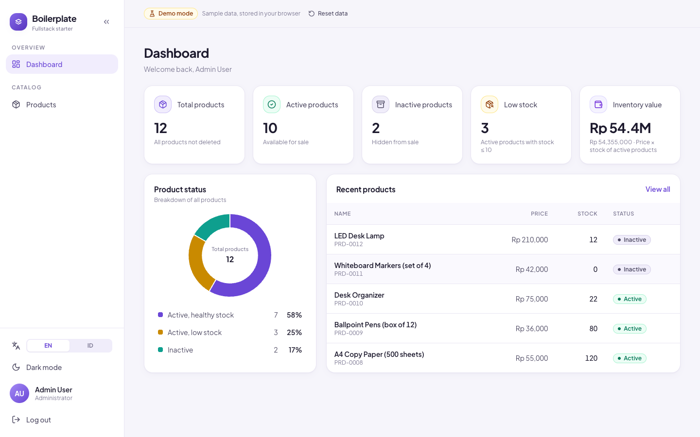
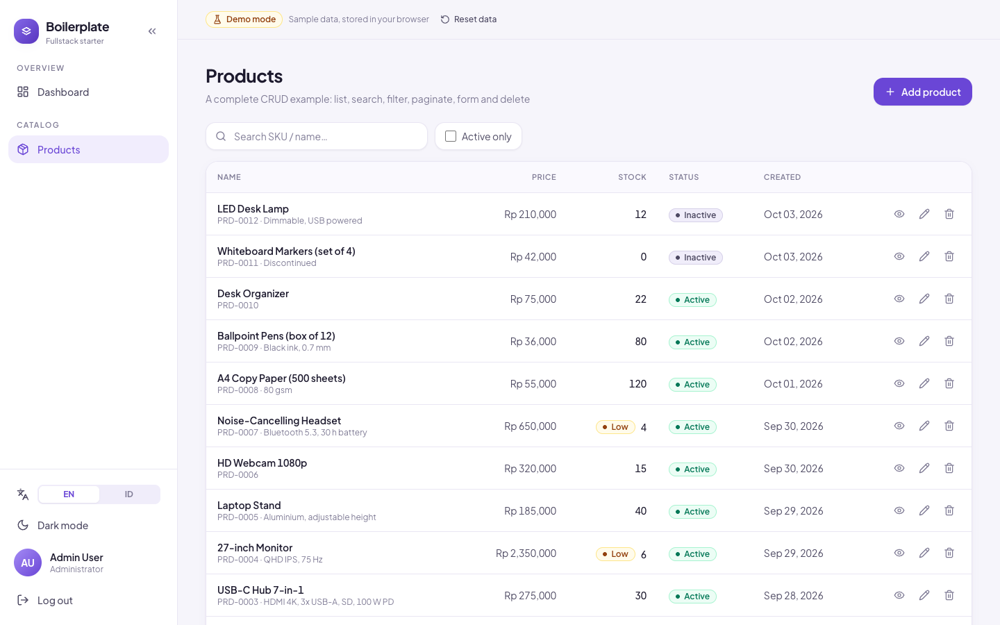
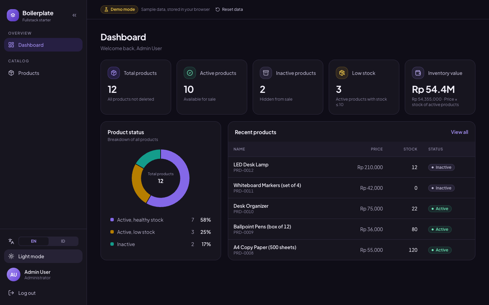
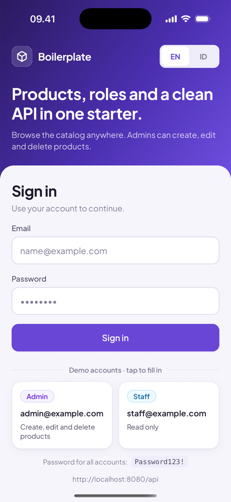

# Fullstack Boilerplate

A starter for business apps with one codebase per platform: a **Go REST API**, a **React web app**, and a **React Native app for Android and iOS**, all talking to **SQL Server**.

It ships with what most projects end up rebuilding: JWT login, role-based permissions, a dashboard, one complete CRUD module (products) wired end to end, audit logging, translated errors, English/Indonesian UI, dark mode, and a backend-free demo mode for the web app. Replace the products module with your own domain and keep the rest.



| Products                                       | Dark mode                                           | Mobile (iOS)                                                              |
| ---------------------------------------------- | --------------------------------------------------- | ------------------------------------------------------------------------- |
|  |  |  |

## What's included

- **Auth:** email + password login, bcrypt hashes, HS256 JWT, `401` handling that signs the user out on web and mobile.
- **Permissions:** the role → permission map lives in one place in the backend (`pkg/constantvar`). Clients read `permissions` from `GET /api/auth/me` and never check role names.
- **Example module:** products with list (search, filter, pagination), detail, create, edit and soft delete, on every platform.
- **Transactions & audit:** writes and their `AuditLogs` row commit in one database transaction (`repository.Transactor`, tx carried in `context`).
- **i18n:** English and Indonesian. The backend translates error titles and messages from `Accept-Language`; the clients use typed dictionaries where a missing key fails the typecheck.
- **Consistent API:** one response envelope, one pagination shape, stable error codes. See [docs/API.md](docs/API.md).
- **Web demo mode:** `npm run dev:demo` runs the web app against an in-browser mock API, so it can be deployed as a static site (e.g. Vercel) with no backend.
- **Tooling:** Swagger docs, GoMock + Testify tests, ESLint + Prettier, Husky + lint-staged, Jest, and GitHub Actions CI for all three apps.

## Tech stack

| Part     | Stack                                                                                                            |
| -------- | ---------------------------------------------------------------------------------------------------------------- |
| Backend  | Go 1.22, Gin, GORM, Viper, golang-jwt, go-i18n, zap, Swaggo, Testify + GoMock                                      |
| Frontend | React 18, TypeScript, Vite, Tailwind CSS, Redux Toolkit (RTK Query), React Router, react-hook-form + yup, lucide |
| Mobile   | React Native 0.87 (New Architecture, Hermes), React 19, TypeScript, React Navigation 7, RTK Query, Keychain      |
| Database | SQL Server 2022 (Docker)                                                                                         |

## Project layout

```
.
├── backend/    Go REST API: controller → usecase → repository        → backend/README.md
├── frontend/   React web app (+ demo mode)                            → frontend/README.md
├── mobile/     React Native app, Android + iOS                        → mobile/README.md
├── db/         docker-compose for SQL Server, schema and dev seed     → db/README.md
└── docs/       API contract and screenshots
```

## Quick start

Prerequisites: Docker (Docker Desktop or Colima), Go 1.22+, Node.js 20+ (Node 22.11+ for mobile), Make. For mobile: JDK 17 + Android SDK and/or Xcode + CocoaPods.

**1. Database**

```sh
cd db
cp example.env .env          # set MSSQL_SA_PASSWORD
docker compose up -d
```

Then load `init/01_schema.sql` and `init/02_seed_dev.sql` with `sqlcmd -I` (exact commands in [db/README.md](db/README.md)).

**2. Backend** (http://localhost:8080, Swagger at `/swagger/index.html`)

```sh
cd backend
cp example.env .env          # set SQL_SERVER_URI and JWT_SECRET (openssl rand -hex 32)
make run
```

**3. Frontend** (http://localhost:5173)

```sh
cd frontend
cp .env.example .env
npm install
npm run dev                  # or: npm run dev:demo  (no backend needed)
```

**4. Mobile**

```sh
cd mobile
nvm use                      # Node 22.11+
npm install
npm run android              # Android emulator, API at 10.0.2.2:8080
# iOS: cd ios && bundle install && bundle exec pod install && cd .. && npm run ios
```

Dev accounts (password `Password123!`):

| Email               | Role  | Can                            |
| ------------------- | ----- | ------------------------------ |
| `admin@example.com` | ADMIN | read + create/edit/delete products |
| `staff@example.com` | STAFF | read only                      |

## Starting a new project from this template

1. Click **Use this template** on GitHub (or clone and delete `.git`).
2. Rename things: Go module path in `backend/go.mod`, `SERVICE_NAME`, database name `AppDb`, `VITE_APP_NAME`, and the mobile app name / bundle id (step by step in [mobile/README.md](mobile/README.md)).
3. Add your own modules next to `products`. The backend README has a checklist (entity → repository → usecase → controller → route → registry → mocks → swagger → tests). Update [docs/API.md](docs/API.md) and the matching API slices in `frontend/src/api` and `mobile/src/core/api`.
4. Set real secrets through environment variables in production; never commit `.env` files.

## Checks

```sh
cd backend  && make test
cd frontend && npm run typecheck && npm run lint && npm run build
cd mobile   && npm run typecheck && npm run lint && npm test
```

CI runs the same checks on every push and pull request (`.github/workflows/ci.yml`).

## License

[MIT](LICENSE)
